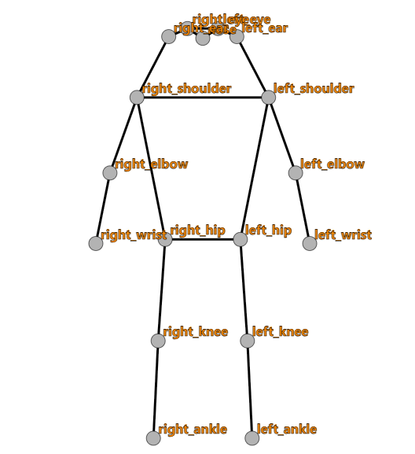
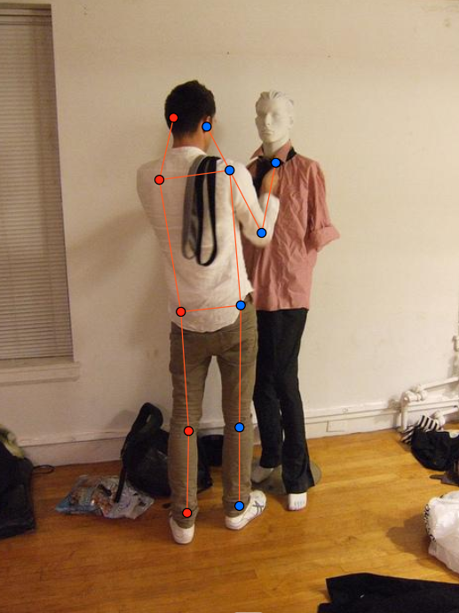
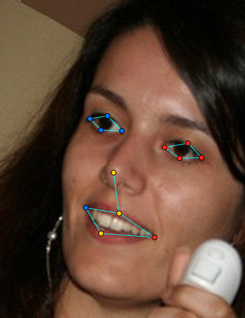

# Báo cáo cá nhân — DoTuanLong-2A202604066

Dữ liệu: 12 ảnh người COCO val2017 (Lin et al., 2014) và 8 ảnh chân dung Wikimedia Commons, chỉ dùng trong lớp.

## 0. Thông tin học viên

- Họ tên: Do Tuan Long
- MSSV: 2A202604066
- Email: itslongforwork@gmail.com
- Link repository: https://github.com/superuj-coder/K5-L2B-DoTuanLong-2A202604066-KeypointPose-Student
- Phiên bản CVAT (Help → About): 2.82.1 (đọc từ CVAT local)
- Máy: Windows · RAM 8 GB · chạy CVAT chế độ lite
- Bộ ảnh (`src/exports/assignment.json` do `lab.py setup` tạo): có (`src/exports/assignment.json` tồn tại)
- Giờ bắt đầu: 05:00
- Giờ kết thúc: 07:00

## 1. Kiểm tra label (CP0)

| Label | Kiểu | Số điểm | Tên điểm đúng bảng của lab? | Đúng thứ tự? | Số cạnh |
|---|---|---:|---|---|---:|
| `person` | Skeleton | 17 | Có | Có | 19 |
| `face` | Skeleton | 13 | Có | Có | 13 |

Mẫu `person` dựng theo người quay mặt về camera (các điểm `left_*` nằm bên phải khung mẫu)? Có

Cách đổi cờ `occluded` / `outside` cho **một điểm** trên phiên bản CVAT này (một câu):

Rê chuột vào đúng điểm rồi bấm `Q` để bật/tắt `occluded` hoặc `O` để bật/tắt `outside`.

## 2. Số lượng đã gán và thời gian (CP1, CP2)

| Nhóm ảnh | Số ảnh | Số skeleton đã gán | Số người dưới 60 px (không gán) | Số poster / gương / màn hình bỏ qua | Thời gian (phút) |
|---|---:|---:|---:|---:|---:|
| `easy` | 5 | 5 | 0 | 0 | 10 |
| `occluded` | 3 | 4 | 0 | 0 | 15 |
| `back` | 2 | 3 | 0 | 0 | 20 |
| `small` | 1 | 2 | 1 | 0 | 25 |
| `crowd` | 1 | 3 | 2 | 0 | 20 |
| `faces` | 8 | 8 | — | Chưa ghi | 30 phút |

- Số ảnh người đã xong ở mốc phút 105: 12 / 12
- Thời gian thực tế (phút): CP1 30 · CP2 30 · CP3 30
- Ảnh tốn thời gian nhất là ảnh nào, vì sao?

Ảnh `000000469061.jpg`: có hai người chồng lấp nhau và nhiều điểm bị khuất, nên phải ước lượng vị trí các điểm tay/chân; các điểm không xác định chắc được gán `occluded`.

## 3. Bảng ca khó (CP1, CP2)

Mỗi điểm bạn phân vân một dòng, nhất là phân vân giữa `v = 1` và `v = 0`, hoặc không chắc hướng người.

| Ảnh | Người / mặt | Điểm | Cờ đã chọn | Phân vân giữa | Lý do chọn |
|---|---|---|---:|---|---|
| `000000469061.jpg` | người ở phía sau | tay/chân phải và trái bị che | `occluded` (v=1) | v=1 hay v=0 | Tự ước lượng vị trí các phần tay chân bị che và gán occluded. |
| | | | | | |
| | | | | | |

## 4. Bảng tự review (CP3)

Đi từ ảnh cuối về ảnh đầu. 5 ảnh người (ít nhất 2 ảnh `back` hoặc `crowd`) và 3 ảnh mặt. Ít nhất 8 dòng, kể cả dòng `ok`. Ghi lỗi trước, sửa sau.

Mã lỗi dùng đúng một trong: `lr_swap`, `vis_flag`, `position`, `missing`, `extra`, `ok`.

| Ảnh | Người / mặt | Điểm | Mã lỗi | Ghi chú | Đã sửa? |
|---|---|---|---|---|---|
| Tên ảnh chưa ghi lại | người | — | `ok` | Đã review, không phát hiện lỗi cần sửa | Không |
| Tên ảnh chưa ghi lại | người | — | `ok` | Đã review, không phát hiện lỗi cần sửa | Không |
| Tên ảnh chưa ghi lại | người | — | `ok` | Đã review, không phát hiện lỗi cần sửa | Không |
| Tên ảnh chưa ghi lại | người | — | `ok` | Đã review, không phát hiện lỗi cần sửa | Không |
| Tên ảnh chưa ghi lại | người | — | `ok` | Đã review, không phát hiện lỗi cần sửa | Không |
| Tên ảnh chưa ghi lại | mặt | — | `ok` | Đã review, không phát hiện lỗi cần sửa | Không |
| Tên ảnh chưa ghi lại | mặt | — | `ok` | Đã review, không phát hiện lỗi cần sửa | Không |
| Tên ảnh chưa ghi lại | mặt | — | `ok` | Đã review, không phát hiện lỗi cần sửa | Không |

Tổng hợp số lỗi theo mã:

| `lr_swap` | `vis_flag` | `position` | `missing` | `extra` | `ok` |
|---:|---:|---:|---:|---:|---:|
| 0 | 0 | 0 | 0 | 0 | 8 |

Điểm còn phân vân giữa `v = 1` và `v = 0` (ghi cả hai lựa chọn và lý do chọn): ca ở `000000469061.jpg` đã ghi tại mục 3; bạn chọn `occluded` vì tự ước lượng được các phần tay chân bị che.

## 5. Kiểm file xuất và kết quả tự kiểm (CP4)

Tự kiểm tay trong file JSON:

| File | Người / mặt kiểm (ảnh, thứ tự) | Số phần tử `keypoints` | Điểm `outside` ra `v = 0`, `occluded` ra `v = 1`? | `num_keypoints` khớp? |
|---|---|---:|---|---|
| `DoTuanLong_persons.zip` | `000000043968.jpg`, annotation đầu | 51 | Có v=1 và v=2; checker xác nhận ánh xạ cờ | Có (`num_keypoints=17`) |
| `DoTuanLong_persons.zip` | Chưa kiểm annotation thứ hai bằng mắt | 51 theo schema | Checker xác nhận định dạng | Có theo checker |
| `DoTuanLong_faces.zip` | Ảnh đầu, annotation đầu | 39 | Annotation này có v=2; checker xác nhận định dạng cờ | Có (`num_keypoints=13`) |

Sau khi xuất, CVAT ghi `occluded` thành `v = 1` và `outside` thành `v = 0`. Tọa độ của điểm `outside` trong file là tọa độ cũ (theo ghi chú của script; không phải lỗi).

Hai job đã chuyển sang completed trên CVAT? Có (theo xác nhận của học viên)

Dán phần **TÓM TẮT** in ra từ `src/check_submission.py`:

```text
- File person: DoTuanLong_persons.zip
  Số ảnh: 12 · số skeleton `person`: 17 · mỗi annotation 51 số
  Skeleton theo ảnh: 000000043968=1, 000000090646=1, 000000106051=2, 000000123544=2, 000000194027=1, 000000225138=1, 000000381889=3, 000000451084=1, 000000455536=1, 000000461002=1, 000000469061=2, 000000516902=1
  Cờ v: v=2 228 (79%) · v=1 37 (13%) · v=0 24 (8%)
  num_keypoints trung bình: 15.6
- File face: DoTuanLong_faces.zip
  Số ảnh: 8 · số skeleton `face`: 8 · mỗi annotation 39 số
  Skeleton theo ảnh: face_105668=1, face_145751=1, face_219250=1, face_223746=1, face_279764=1, face_380754=1, face_496353=1, face_92028=1
  Cờ v: v=2 95 (91%) · v=1 9 (9%) · v=0 0 (0%)
  num_keypoints trung bình: 13.0
- Ghi chú: 24 điểm v = 0 vẫn mang tọa độ cũ (CVAT 2.x xuất như vậy; chuẩn COCO ghi 0, 0). Không phải lỗi: điểm v = 0 bị bỏ qua khi huấn luyện và khi chấm.
- Số [LỖI]: 0 · số [CẢNH BÁO]: 3
Kết quả: ĐẠT (đọc lại từng cảnh báo ở trên)
```

Các `[CẢNH BÁO]` còn giữ nguyên và lý do:

Giữ ba cảnh báo heuristic vì sau khi xem lại trên CVAT, học viên nhận định các vị trí phản ánh tư thế/độ chồng lấp trong ảnh, không phải lỗi đổi trái/phải. Cảnh báo nhắc kiểm tra các cặp hip/knee/ankle ở `000000043968.jpg`, knee ở `000000123544.jpg`, và knee/ankle ở `000000225138.jpg`.

## 6. Ảnh chụp màn hình

1. Label `person` trong label constructor (đủ 17 điểm có tên):

   

2. Một người quay lưng đã gán, cờ đã đặt:

   

3. Một khuôn mặt đã gán 13 điểm, phóng to vùng mắt:

   

4. Một đoạn JSON xuất của một người:

   ```json
   {
     "image": {
       "id": 1,
       "file_name": "000000043968.jpg",
       "width": 640,
       "height": 426
     },
     "annotation": {
       "id": 1,
       "image_id": 1,
       "category_id": 1,
       "area": 32410.7605,
       "bbox": [158.33, 79.96, 161.69, 200.45],
       "keypoints": [
         276.17, 90.96, 2,
         284.31, 88.29, 2,
         272.8, 83.51, 2,
         282.19, 96.62, 2,
         261.36, 79.96, 1,
         265.8, 126.51, 2,
         241.79, 89.52, 2,
         279.97, 166.35, 2,
         195.4, 94.15, 2,
         320.02, 180.37, 2,
         158.33, 115.93, 2,
         204.78, 187.79, 2,
         231.81, 181.22, 2,
         229.88, 231.58, 1,
         254.44, 223.82, 2,
         208.43, 280.41, 2,
         252.62, 278.62, 2
       ],
       "num_keypoints": 17
     }
   }
   ```

## 7. Tự đánh giá

1. Lỗi bạn mắc nhiều nhất hôm nay, và cách bạn sẽ tránh ở dự án thật:

   Không mắc lỗi gì.

2. Một quy tắc bạn đề xuất thêm vào guideline (kèm ảnh ví dụ nếu có):

   Nếu được, nên làm thành một file hướng dẫn tuyến tính; các file hướng dẫn hiện nằm rải rác, khó nhớ và dễ bị rối.

3. Nhãn của bạn đi vào model ở đâu? Chọn một lỗi bạn đã sửa và nói nó sẽ làm model học sai thế nào (heatmap, trọng số trong loss, hay bước lật ảnh):

   Nhãn đi vào model khi tạo task, lúc tạo task thì mình định nghĩa các nhãn cho model
   Không có lỗi để sửa


## 8. Khó khăn và lỗi kỹ thuật

Không báo cáo lỗi kỹ thuật. Ảnh `000000469061.jpg` là ca khó nhất do hai người chồng lấp và nhiều điểm tay/chân bị che.

## Bonus (nếu làm)

### B1 — 3 ảnh người khó thêm

| Ảnh | Số skeleton | Số người dưới 60 px | Ca khó nhất |
|---|---:|---:|---|
| | | | |
| | | | |
| | | | |

Kết quả `src/check_submission.py` cho `DoTuanLong_bonus_persons.zip`:

```text
(Chưa làm bonus.)
```

### B2 — 5 ảnh khuôn mặt đen trắng / hồng ngoại

Ảnh không màu khó hơn ở điểm nào? Kính râm trên ảnh hồng ngoại có còn là `v = 1` không?

Chưa làm bonus.

### B3 — Model so với nhãn của tôi (không tính điểm)

- Demo đã dùng:
- Ảnh đã thử:

1. Model có trả điểm cho khớp bị che, hay khớp ngoài ảnh không? Confidence ở các điểm đó thế nào?

   (Chưa làm bonus B3.)

2. Với người quay lưng, model có đổi trái/phải không?

   (Chưa làm bonus B3.)

3. Bộ điểm của model có giống 17 điểm COCO không?

   (Chưa làm bonus B3.)

## 9. Tài liệu tham khảo và công cụ AI đã dùng

Đã dùng ChatGPT/Codex để giải thích cờ `occluded`/`outside` và hỗ trợ sắp xếp các thông tin kỹ thuật đã có vào báo cáo. Không dùng AI để tạo nhãn hoặc tọa độ keypoint.
